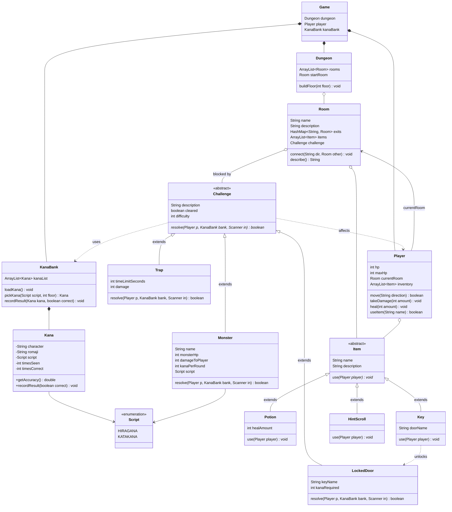

# Proposal | Davian

## Purpose
This project is intended to demonstrate mastery of concepts learned in CSC 121. This project was also made as a way for others to get a small glimpse of the world of language learning. 

## Overview
KanaGame is a text based dungeon crawler made to teach players the basic Japanese alphabet.  It will feature 5-6 floors of both Hiragana, the main alphabet, and Katakana, which the alphabet primarily used for loan words taken from other languages. 

## Classes
This project relies on 10 classes and 1 enum all shown in the diagram below as well as explained here.

### Game class
- Creates the dungeon
- Creates the player
- Creates the bank that holds the characters for the game
 
### Player class
- Sets current HP for player
- Sets max HP for player 
- Holds the item in the "inventory" for player

### Dungeon class
- Holds the list of all the rooms
- Remembers which room the player starts in
- Builds each floor by creating the rooms and connecting them

### Room class
- Has a name and a description
- Holds the exits to other rooms (north, south, east, west)
- Holds the items lying on the floor
- Connects to other rooms
- Describes itself to the player

### KanaBank class
- Holds the list of all Hiragana and Katakana
- Loads the characters when the game starts
- Picks which character to quiz the player on
- Picks characters the player gets wrong more often
- Records whether each answer was right or wrong

### Item class (abstract)
- Has a name and a description
- Is the parent for every item in the game
- Forces each item type to define its own `use()` method

### Potion class
- Extends Item
- Holds how much HP it heals
- Heals the player when used

### Key class
- Extends Item
- Holds the name of the door it opens
- Unlocks that door when used

### HintScroll class
- Extends Item
- Shows the romaji for the next kana question when used

### Kana class
- Holds one character, like あ
- Holds its romaji, like "a"
- Holds which script it belongs to
- Counts how many times it was shown
- Counts how many times the player got it right
- Calculates the player's accuracy for that character

### Script (enum)
- Has two values: HIRAGANA and KATAKANA
- Tells each kana which writing system it belongs to

## Anticipated Use Case
Players will be able to run through and clear preset dungeons. The program is single-player and runs in the command line, so the player only needs to type short commands.

## Use of Object-Oriented Programming Paradigms
- Inheritance - Three challenge classes (Monster, LockedDoor, and Trap) inherit from the abstract Challenge class, and three item classes (Potion, Key, and HintScroll) inherit from the abstract Item class.
- Aggregation - The Dungeon class holds a list of Room objects, and each Room holds a list of Item objects. The Player also holds a list of Item objects in its inventory. Items exist independently of whoever holds them, and they move from a room into the player's inventory when the player picks them up.
- Encapsulation - All of the data members are private and accessible only through methods. For example, a player's hp can only be changed through takeDamage() and heal(), which keep it from dropping below 0 or going above maxHp. A monster's HP is changed only through its own takeDamage() method.
- Polymorphism - Challenge has an abstract resolve() method and Item has an abstract use() method, which each subclass implements in its own way. When the player enters a room, Game calls resolve() on the room's challenge without knowing whether it is a Monster, LockedDoor, or Trap. A Player calls use() on items in its inventory without knowing whether each is a Potion, Key, or HintScroll.

## Technology
My project is certainly possible in the other languages we've learned in this class. I will use Java on this project. 

## Diagram

